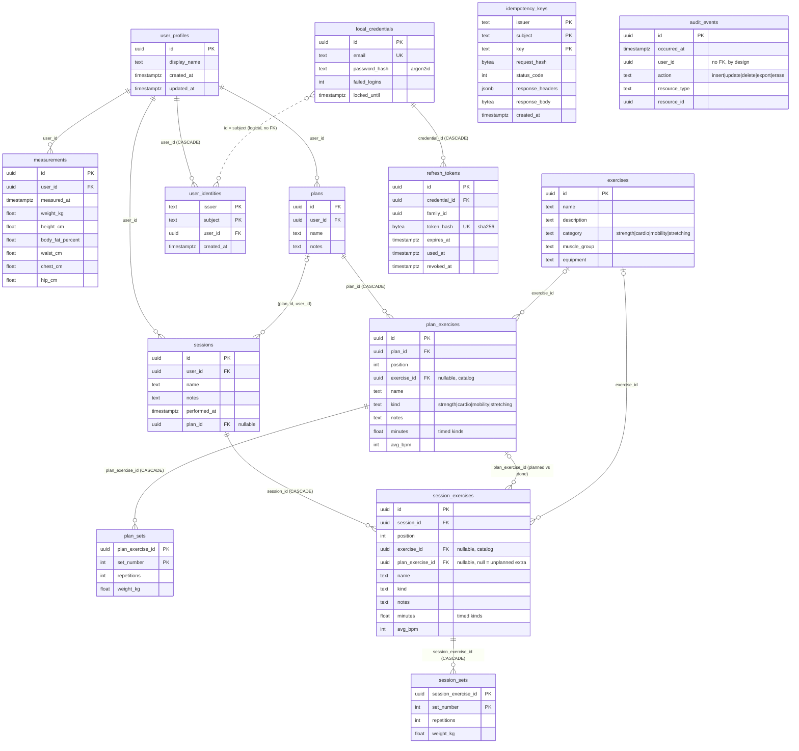

# Database structure

Generated from `migrations/000001`–`000008`. The migrations are the source of truth; update this file when you add one.

## Tables

| Table | Migration | Purpose |
|---|---|---|
| `exercises` | 1, seeded by 8 | Shared, read-only exercise catalog |
| `user_profiles` | 2 | The local user; every user-owned row hangs off it |
| `measurements` | 2 | Body measurements over time |
| `plans` | 2 | Workout plans (header: name, notes) |
| `plan_exercises`, `plan_sets` | 7 | What a plan asks for: exercises in order, each with its sets |
| `sessions` | 2 | Performed workouts (header); optional link to a plan |
| `session_exercises`, `session_sets` | 7 | What was done, each exercise optionally pointing at the planned one it fulfils |
| `user_identities` | 3 | Maps (issuer, subject) from an auth provider to a profile |
| `local_credentials` | 4 | Built-in JWT provider accounts (email + argon2id hash) |
| `refresh_tokens` | 4 | Hashed, rotating refresh tokens grouped in families |
| `idempotency_keys` | 5 | Cached POST responses, kept 24h |
| `audit_events` | 6 | Append-only log of who changed what, never values |

## Notable design choices

- **Planned vs done is a join.** `session_exercises.plan_exercise_id` points at the `plan_exercises` row it fulfils; `NULL` means unplanned extra work. `GET /api/v1/stats/progress` sums `plan_sets`/`session_sets` in SQL.
- **Frozen plans.** Once any session uses a plan, its exercises and sets cannot change (the API answers `409 plan_in_use`; name and notes can still change). That keeps past comparisons and statistics true without copying the plan into every session.
- **Catalog link is optional.** `exercise_id` ties an entry to the catalog for aggregation; `name` is always stored so a free-form exercise works too. Strength entries have sets; every other kind is timed (`minutes`).
- `sessions` references plans through a composite FK `(plan_id, user_id)`, so a session can never point at another user's plan.
- `audit_events` has no FK to `user_profiles`, so records survive erasure of the user. Triggers write it in the same transaction as the change, on the four parent tables; exercise and set rows are only ever rewritten together with their parent, which bumps its `updated_at`. The API role can only `INSERT` into it.
- `user_identities` is keyed by `(issuer, subject)`, and cascades when a profile is deleted.
- Primary keys are time-ordered UUIDv7 values generated in Go (`internal/ids`), so inserts append to the index.
- Migration 7 discarded the JSONB-era plans and sessions; its down migration empties them again.
