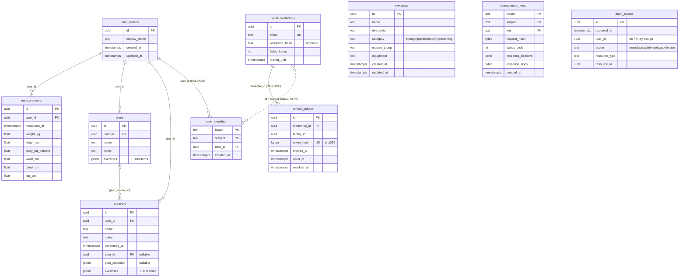

# Database structure

Generated from `migrations/000001`–`000006`. The migrations are the source of truth; update this file when you add one.

## Tables

| Table | Migration | Purpose |
|---|---|---|
| `exercises` | 1 | Global exercise catalog, not user-owned |
| `user_profiles` | 2 | The local user; every user-owned row hangs off it |
| `measurements` | 2 | Body measurements over time |
| `plans` | 2 | Workout plans; exercises/sets stored as one JSONB document |
| `sessions` | 2 | Performed workouts; optional link to a plan plus a snapshot of it |
| `user_identities` | 3 | Maps (issuer, subject) from an auth provider to a profile |
| `local_credentials` | 4 | Built-in JWT provider accounts (email + argon2id hash) |
| `refresh_tokens` | 4 | Hashed, rotating refresh tokens grouped in families |
| `idempotency_keys` | 5 | Cached POST responses, kept 24h |
| `audit_events` | 6 | Append-only log of who changed what, never values |

## Notable design choices

- `sessions` references plans through a composite FK `(plan_id, user_id)`, so a session can never point at another user's plan.
- `audit_events` has no FK to `user_profiles`, so records survive erasure of the user. Triggers write it in the same transaction as the change. The API role can only `INSERT` into it.
- `user_identities` is keyed by `(issuer, subject)`, and cascades when a profile is deleted.
- Plan and session exercise lists are JSONB documents, always read and written whole. Their shape is validated in Go (`internal/training`).
